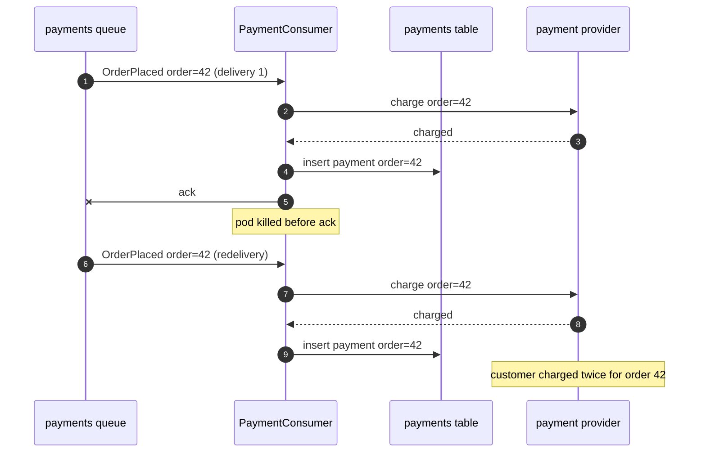

# Report format

Write the reply in this structure. Keep headings, field names, and vocabularies exactly as
given, so reports from different runs can be merged.

## Vocabularies

**Damage**, worst first. Pick the single worst outcome the finding can produce:

1. `lost` — data or work disappears with no record that it existed.
2. `corrupted` — persisted data is wrong, inconsistent, or under the wrong tenant.
3. `irreversible-effect` — an external effect (money, message, third-party write, delete)
   that cannot be undone.
4. `duplicated` — the same effect applied more than once.
5. `incomplete` — part of a multi-step operation persisted, the rest missing.
6. `outage` — production, or a critical flow, stops working.

**Likelihood**, most likely first:

1. `every-run` — happens on the normal path.
2. `on-retry` — happens whenever a normal retry, redelivery, re-run, or double submit occurs.
3. `on-concurrency` — needs two executions to overlap in an ordinary way under normal load.
4. `on-deploy` — happens during a rolling deploy, a rollback, or a flag change.
5. `rare-race` — needs an unusual interleaving or timing.
6. `operator-error` — needs a manual mistake (wrong replay, wrong flag, wrong command).

**Evidence**: `reproduced` (ran in isolation and observed it), `traced` (followed the
code path end to end), `inferred` (depends on a runtime fact you could not verify; name it).

Order findings by likelihood, then by damage.

## Template

````markdown
# Pre-mortem: <short name of the change>

**Scope:** <base..head, paths, or "branch vs merge-base with <default>, plus uncommitted">
**Intent:** <one sentence, and its source: PR, ticket, commits, or "not found">
**Language server:** <used: which | available but not used: why | not found>

## Summary

| # | Finding | Damage | Likelihood | Evidence |
|---|---------|--------|------------|----------|
| 1 | <what goes wrong in production> | <damage> | <likelihood> | <evidence> |

<If nothing survived step 4, replace the table with "No critical findings." and keep the
other sections.>

## Findings

### 1. <what goes wrong in production>

- **Damage:** <damage> — <what exactly is lost, corrupted, duplicated, …>
- **Likelihood:** <likelihood> — <the real-world event that sets it off>
- **Evidence:** <evidence> — <the test you ran, or the unverified runtime fact>
- **Where:** <file:line of the failing step, or where the missing guard belongs>
- **Entry point:** <handler, consumer, job, or command that starts the path>
- **Guards checked:** <what would prevent it, and why it does not>
- **Detection:** <who or what notices, and when; "nobody until reconciliation" is an answer>

**Sequence**

```mermaid
<sequenceDiagram of the failure, see rules below>
```

**Steps to reproduce**

1. <the starting state: which rows, messages, flags, versions exist>
2. <each action, matching the numbered arrows in the diagram>
3. <the failure injected: kill, timeout, duplicate delivery, concurrent call, …>
4. <the state to inspect, and what it shows>

**Fix direction:** <one or two sentences; not a patch>

## Refuted candidates

- <candidate> — <the guard or fact that refuted it, with file:line>

## Coverage

- **Blast radius:** <how it was mapped; symbols that could not be resolved>
- **Entry points traced:** <list>
- **Entry points not traced:** <list, and why: budget, unresolvable, out of repo>
- **Categories clean:** <failure-mode category — the code path it was checked against>
- **Unverified assumptions:** <delivery semantics, retry policy, deploy strategy, prod
  config values>
````

## Diagram rules

Each finding has one `sequenceDiagram` that shows how to get from a healthy state to the
damaged one. A reader should be able to reproduce the failure from the diagram alone.

- Start with `autonumber`, so the steps to reproduce can refer to arrow numbers.
- One `participant` per process, store, or external system that the path touches. Use the
  real names from the code (`OrderConsumer`, `orders table`, `payments queue`).
- Use `->>` for a call or write that succeeds, `-x` for one that fails or never arrives, and
  `-->>` for a reply.
- Mark the failure with `Note over <participant>: <crash, timeout, kill, redelivery>`.
- Show retries and redeliveries as their own arrows, not as a loop, so each repeated effect
  is visible.
- Show concurrent executions with `par` / `and` blocks, one branch per instance.
- End with a `Note over` the store that holds the damage, stating the damaged state.
- Keep labels plain text. Do not use `;`, `#`, or unbalanced quotes in labels; they break the
  parser.
- When `pele` is on `PATH`, validate each diagram with `pele --check`. Fix it until it
  passes.

Example:


